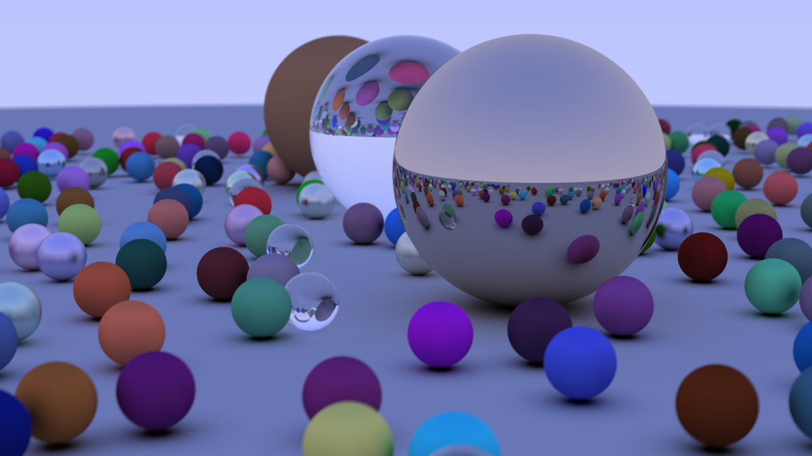

# Raytracing Renderer

A CPU path tracer written from scratch in C++ with no external libraries. It renders 3D scenes of spheres and writes the result as a PPM image.

Built while working through Peter Shirley's [_Ray Tracing in One Weekend_](https://raytracing.github.io/books/RayTracingInOneWeekend.html).

## Sample render



## Features

- **Ray–sphere intersection** with surface normals and front/back face detection
- **Modular scene objects**: anything that implements `hittable` can be added to a `hittable_list`
- **Materials**
  - Lambertian (matte/diffuse)
  - Metal, with adjustable roughness ("fuzz")
  - Dielectric (glass), with refraction via Snell's law, total internal reflection, and Schlick's approximation for reflectance
- **Recursive path tracing** with a configurable bounce limit
- **Anti-aliasing** through random sampling within each pixel (stochastic supersampling)
- **Positionable camera**: set position, look-at point, up vector, and field of view
- **Depth of field** by sampling rays from a thin-lens disk (adjustable aperture angle and focus distance)
- **Gamma correction** on output

## Project layout

| File | Purpose |
| --- | --- |
| `main.cpp` | Builds the scene and camera, then renders |
| `camera.h` | Camera setup, ray generation, and the render loop |
| `material.h` | Lambertian, metal, and dielectric materials |
| `sphere.h`, `hittable.h`, `hittable_list.h` | Scene geometry and hit testing |
| `vec3.h`, `ray.h`, `color.h`, `interval.h`, `helpers.h` | Math and utility types |

## Building and running

```sh
g++ -O2 -std=c++17 main.cpp -o raytrace
./raytrace > output.ppm
```

The image is written to standard output; progress is printed to standard error. Open `output.ppm` with any viewer that supports PPM P3, or convert it to PNG.

The default scene is a field of random diffuse, metal, and glass spheres rendered at 400 x 225 with 50 samples per pixel. Lower `image_width` and `samples_per_pixel` in `main.cpp` for a quick preview.
